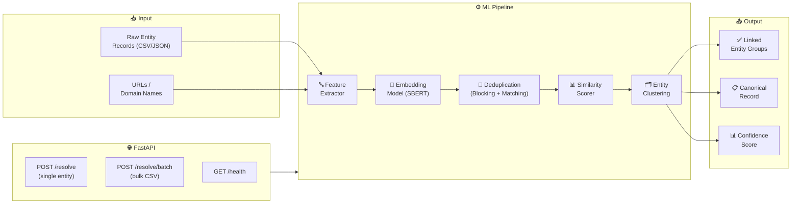

<div align="center">

# 🔗 LinkForge (EntityLink AI)

**High-Performance ML-Powered Business Entity Resolution**

[](https://github.com/harinish45/LinkForge/actions/workflows/ci.yml)
[](LICENSE)
[](https://python.org)

> *High-performance, scalable entity resolution and link analysis system — Amazon ML Challenge 2026*

[📋 TODO](TODO.md) · [📓 Notebooks](notebooks/) · [📚 Docs](docs/)

</div>

---

## 🏗️ Architecture



---

## 🚀 Quick Start

```bash
git clone https://github.com/harinish45/LinkForge.git
cd LinkForge
pip install -r requirements.txt
python -m src.api.main   # → http://localhost:8000
```

---

## 📁 Structure

```
LinkForge/
├── 🐍  src/
│   ├── models/        # ML models
│   ├── api/           # FastAPI endpoints
│   └── processors/    # Link analysis pipeline
├── 📓  notebooks/     # Research notebooks
├── 🧪  tests/         # Test suite
├── ⚙️  configs/       # Configuration
└── 📚  docs/          # Documentation
```

---

<div align="center">
<a href="LICENSE">MIT License</a> · Built by harinish45
</div>