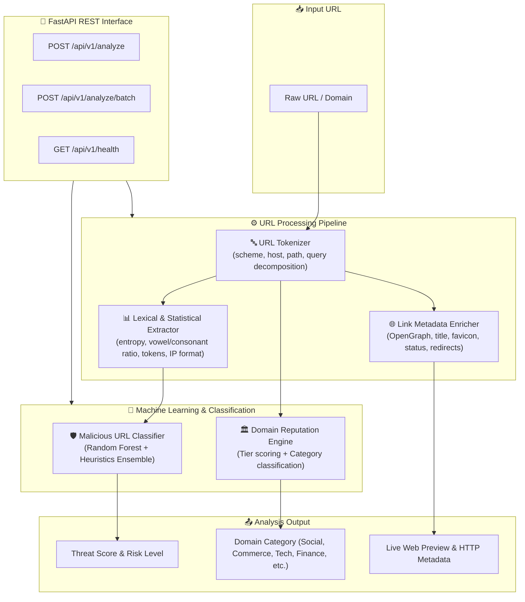

<div align="center">

# 🔗 LinkForge

**Intelligent ML-Powered Link & Domain Analysis Engine**

[](https://github.com/harinish45/LinkForge/actions/workflows/ci.yml)
[](LICENSE)
[](https://python.org)
[](https://fastapi.tiangolo.com)

> *High-performance URL feature extraction, malicious/phishing threat detection, domain reputation scoring, and link metadata enrichment engine.*

[📋 TODO & Master Plan](TODO.md) · [🧪 Tests](tests/) · [📚 Docs](docs/)

</div>

---

## 🏗️ Architecture



---

## 🚀 Key Features

- **Lexical & Statistical Feature Extraction**: Shannon entropy, vowel-to-consonant ratio, domain depth, suspicious tokens, shortening detection, IP detection, special character counts.
- **Hybrid Threat Detection**: Combines a trained scikit-learn pipeline (Random Forest) with heuristic rule scoring to flag phishing, DGA domains, credential harvesting, and brand spoofing.
- **Domain Reputation & Categorization**: Classifies domains into `Social`, `Commerce`, `Tech`, `Finance`, `News`, `Malicious/Phishing`, `Entertainment`, `Government/Education`, and computes reputation scores from 0 to 100 with risk tiers (`TRUSTED`, `NEUTRAL`, `SUSPICIOUS`, `MALICIOUS`).
- **Metadata Enrichment**: Non-blocking asynchronous fetching of webpage title, description, favicon, HTTP status code, response latency, and full redirect chains.
- **FastAPI REST API**: High-throughput endpoints with request validation, batch processing with bounded concurrency (`asyncio.Semaphore`), and structured health checks.

---

## 🛠️ API Reference

### 1. Single URL Analysis
```http
POST /api/v1/analyze
Content-Type: application/json

{
  "url": "https://www.google.com/search?q=cybersecurity",
  "fetch_metadata": false,
  "timeout": 5.0
}
```

### 2. Batch URL Analysis
```http
POST /api/v1/analyze/batch
Content-Type: application/json

{
  "urls": [
    "https://github.com",
    "http://192.168.1.1/paypal/login.php"
  ],
  "fetch_metadata": false,
  "max_concurrency": 10
}
```

### 3. Health Check
```http
GET /api/v1/health
```

---

## 🏁 Quick Start

```bash
# Clone the repository
git clone https://github.com/harinish45/LinkForge.git
cd LinkForge

# Install dependencies
pip install -r requirements.txt

# Run the API server
python -m src.api.main
# Server running on http://localhost:8000 (API Docs at http://localhost:8000/docs)
```

### Running Tests

```bash
python -m pytest tests/test_url_tokenizer.py tests/test_url_features.py tests/test_domain_reputation.py tests/test_ml_classifier.py tests/test_link_metadata.py tests/test_api_endpoints.py -v
```

---

## 📁 Repository Structure

```
LinkForge/
├── 🐍 src/
│   ├── api/               # FastAPI application, routers, Pydantic schemas
│   │   ├── main.py
│   │   ├── routes.py
│   │   └── schemas.py
│   ├── models/            # Malicious URL classifier & Domain reputation engine
│   │   ├── classifier.py
│   │   └── reputation.py
│   └── processors/        # URL tokenization, feature extraction & metadata fetcher
│       ├── features.py
│       ├── metadata.py
│       └── tokenizer.py
├── 🧪 tests/              # Comprehensive unit tests (35+ test cases)
├── ⚙️ configs/            # Configuration files
├── 📚 docs/               # Documentation
├── 📋 TODO.md             # Project roadmap & progress tracker
├── pyproject.toml         # Build system and project metadata
└── requirements.txt       # Project dependencies
```

---

<div align="center">
<a href="LICENSE">MIT License</a> · Built by harinish45
</div>
